# Features

This plugin relies on [clojure-lsp](https://clojure-lsp.io/) features and [lsp4ij](https://github.com/redhat-developer/lsp4ij), so most work is done there, for more detailed information about all clojure-lsp features, check the [server documentation](https://clojure-lsp.io/features/).

### Find a function/var definition

> <kbd>Ctrl/Cmd</kbd> + <kbd>b</kbd> or <kbd>Ctrl/Cmd</kbd> + <kbd>click</kbd>

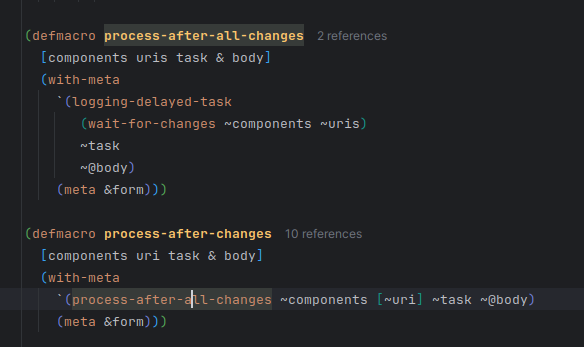

### Find all references of a function, var, keyword or namespace alias

> <kbd>Ctrl</kbd> + <kbd>Alt</kbd> + <kbd>h</kbd>

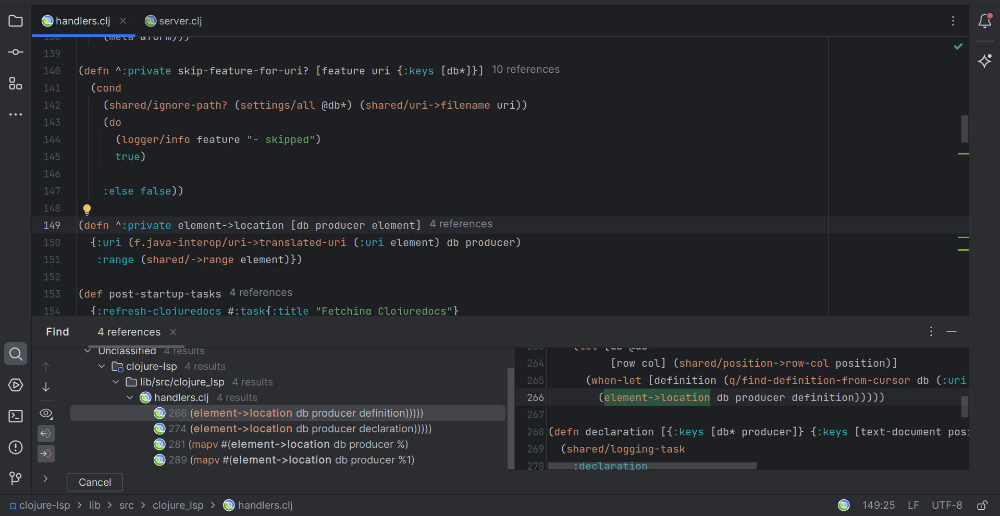

### Find all implementations of a defmulti or defprotocol

> <kbd>Ctrl/Cmd</kbd> + <kbd>Alt</kbd> + <kbd>g</kbd>

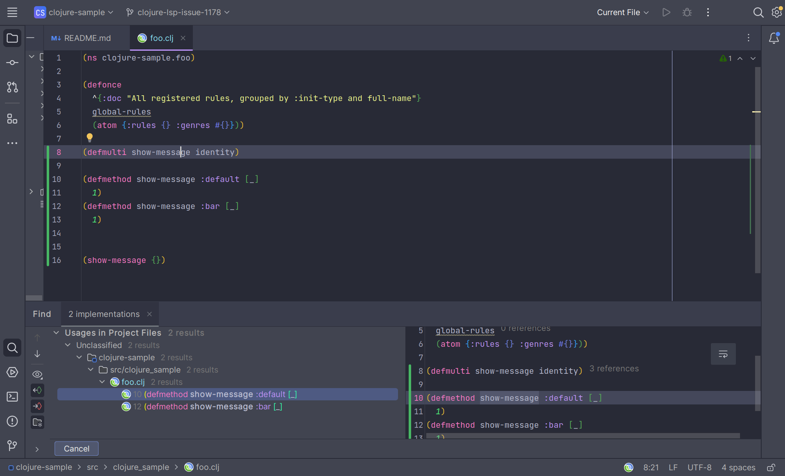

### Rename

> <kbd>Shift</kbd> + <kbd>F6</kbd>

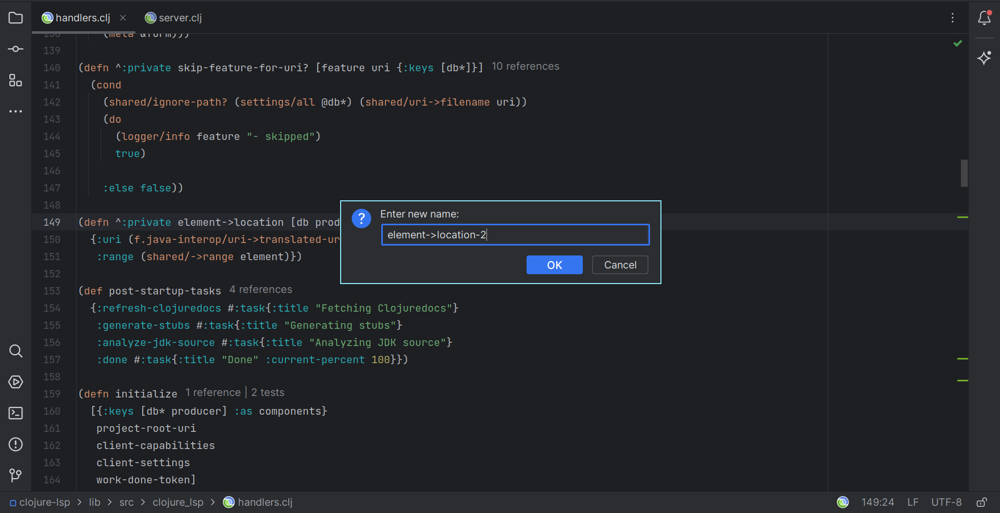

### Documentation and clojuredocs integration

> <kbd>Ctrl/Cmd</kbd> + <kbd>Q</kbd> or mouse hover

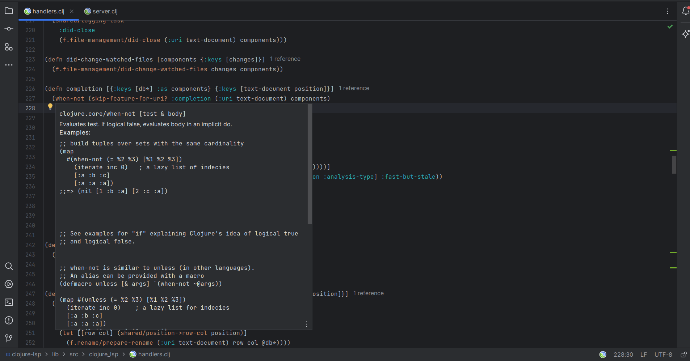

### Completion

> <kbd>Ctrl/Cmd</kbd> + <kbd>SPC</kbd>

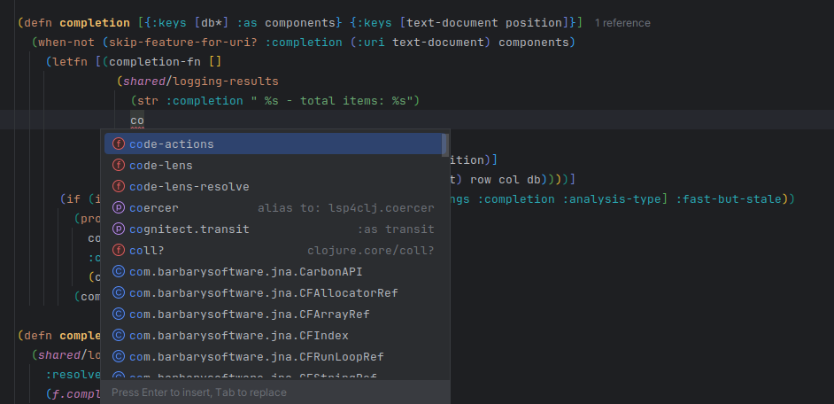

### Code lenses showing symbol references

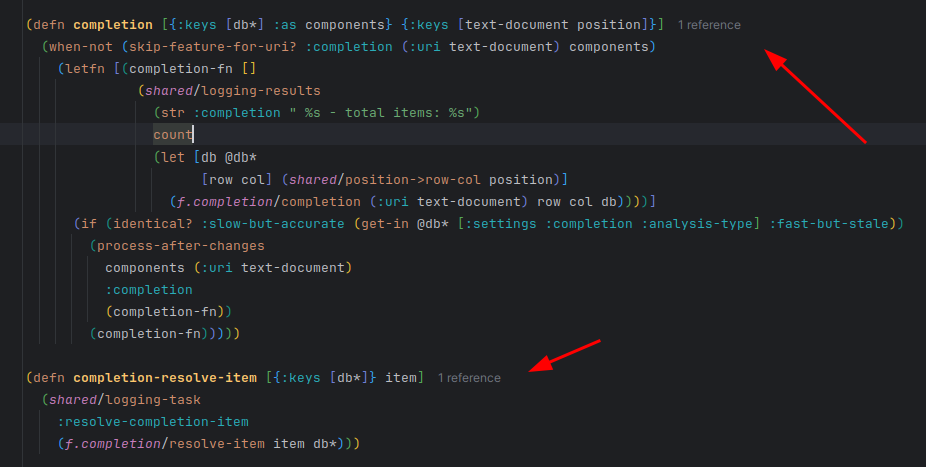

### Diagnostics (linter)

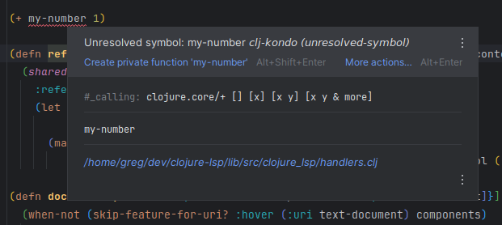

### Format a whole file or range

> <kbd>Ctrl/Cmd</kbd> + <kbd>Alt</kbd> + <kbd>l</kbd>

### Call hierarchy

> <kbd>Ctrl</kbd> + <kbd>Alt</kbd> + <kbd>h</kbd>

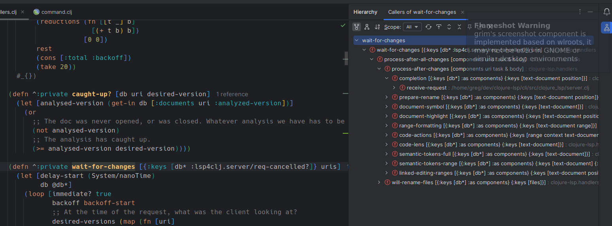

### Document symbols

> <kbd>Ctrl/Cmd</kbd> + <kbd>F12</kbd>

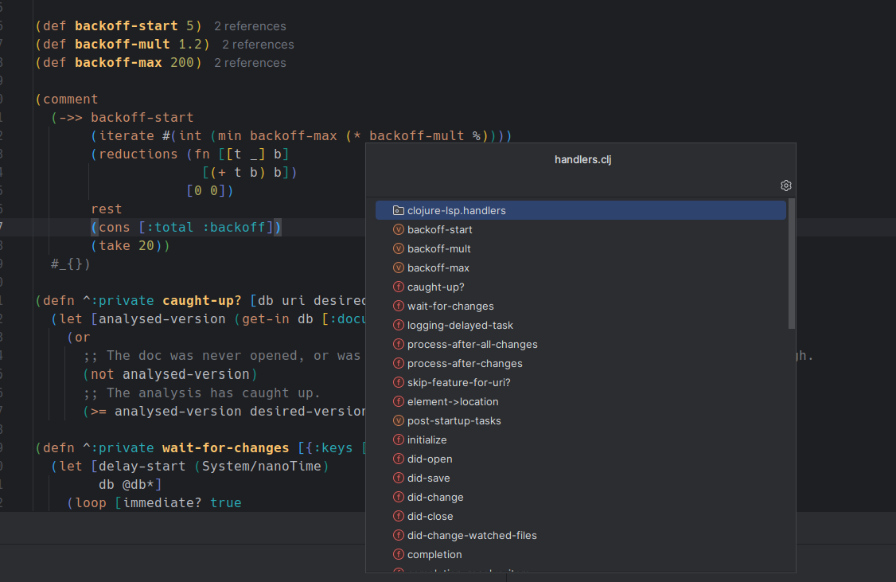

### Wizard to create new Clojure projects

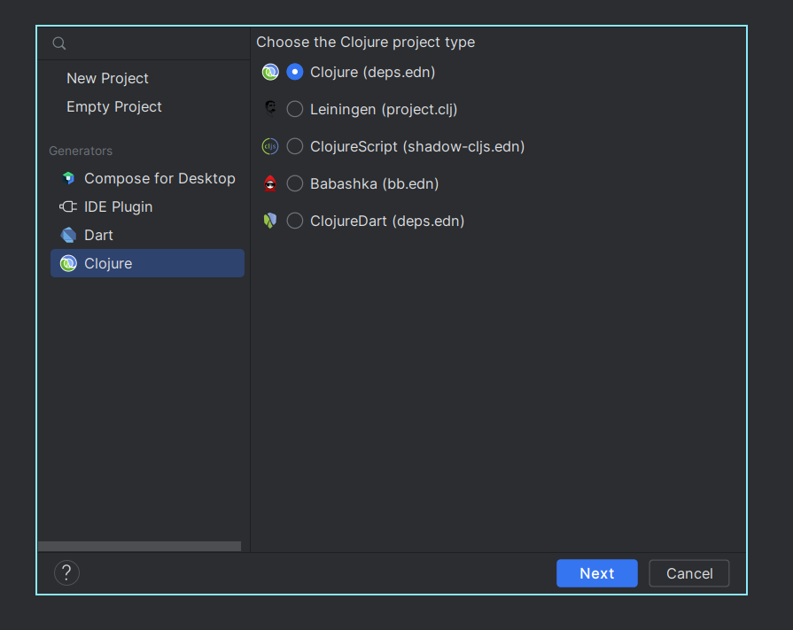

### Code actions

> <kbd>Alt</kbd> + <kbd>Enter</kbd>

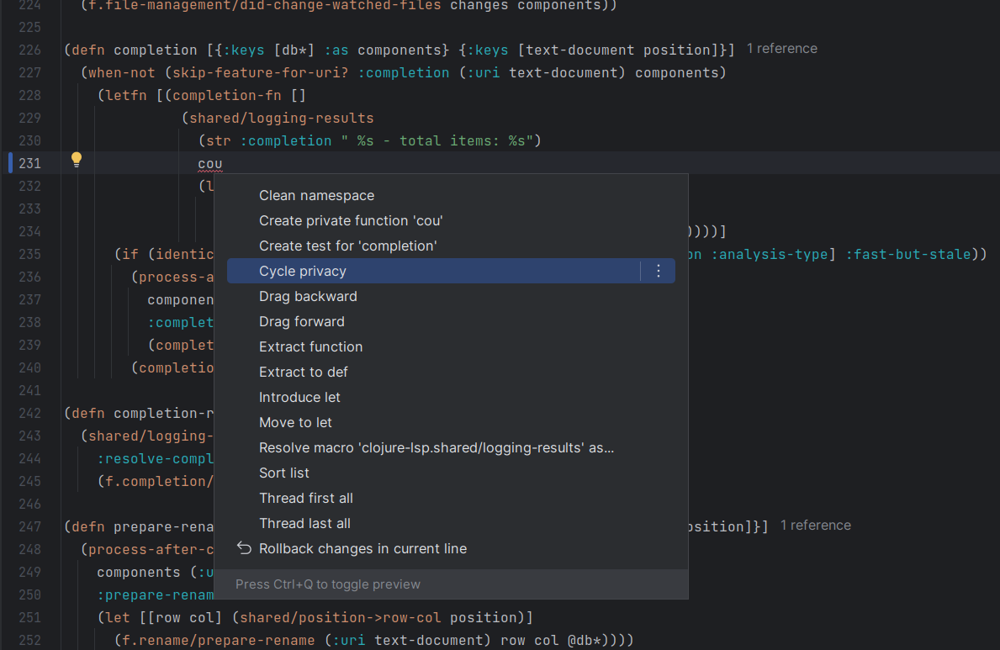

#### Clean namespaces (Organize/Optimize imports)

> <kbd>Ctrl/Cmd</kbd> + <kbd>Alt</kbd> + <kbd>o</kbd>

#### Paredit

##### Forward slurp

> <kbd>Alt</kbd> + <kbd>]</kbd>

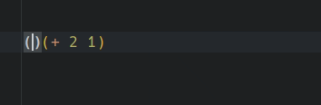

##### Forward barf

> <kbd>Alt</kbd> + <kbd>[</kbd>

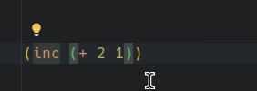

##### Backward slurp

> <kbd>Alt</kbd> + <kbd>Shift</kbd> + <kbd>]</kbd>

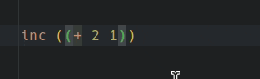

##### Backward barf

> <kbd>Alt</kbd> + <kbd>Shift</kbd> + <kbd>[</kbd>

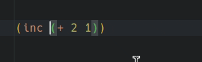

##### Raise sexpr

> <kbd>Alt</kbd> + <kbd>r</kbd>

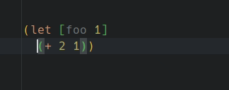

##### Kill sexpr

> <kbd>Alt</kbd> + <kbd>k</kbd>

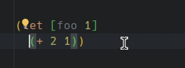

##### Forward sexpr

> <kbd>Ctrl</kbd> + <kbd>Alt</kbd> + <kbd>]</kbd>

##### Forward select sexpr

> <kbd>Ctrl</kbd> + <kbd>Shift</kbd> + <kbd>Alt</kbd> + <kbd>]</kbd>

##### Backward sexpr

> <kbd>Ctrl</kbd> + <kbd>Alt</kbd> + <kbd>[</kbd>

##### Backward select sexpr

> <kbd>Ctrl</kbd> + <kbd>Shift</kbd> + <kbd>Alt</kbd> + <kbd>[</kbd>

##### Structural editing mode

Off by default. Turn it on in `Settings` > `Tools` > `Clojure LSP` > `Editor`, or with the `Toggle structural editing mode` action. While it is on:

- Typing `(`, `[` or `{` inserts the balanced pair, and with a selection wraps it.
- Typing `)`, `]` or `}` moves the caret past the end of the enclosing form instead of inserting an unbalanced bracket.
- Typing `"` inserts an empty string, steps over the closing quote, or inserts `\"` inside a string.
- Typing `;` where it would comment out closing brackets moves the rest of the line to the next one; typing `\` right before a bracket, quote or `;` inserts `\ ` so it does not swallow it.
- <kbd>Backspace</kbd> and <kbd>Delete</kbd> only delete empty pairs and step over non-empty ones; escape sequences and char literals such as `\(` are deleted whole.
- Deleting, cutting or typing over a selection, and deleting or cutting a whole line, only happen when the removed text holds whole forms.
- With several carets the editor keeps its default behavior.

The actions below work whether the mode is on or off. Key bindings follow Cursive.

##### Wrap with (), [] or {}

> <kbd>Ctrl</kbd> + <kbd>Shift</kbd> + <kbd>9</kbd>, <kbd>Ctrl</kbd> + <kbd>[</kbd>, <kbd>Ctrl</kbd> + <kbd>Shift</kbd> + <kbd>[</kbd>

Wraps the selection, or the form at or after the caret.

##### Splice sexpr

> <kbd>Alt</kbd> + <kbd>S</kbd>

`(a (b |c))` → `(a b |c)`. `Splice sexpr killing backward` and `Splice sexpr killing forward` also kill the forms before or after the caret.

##### Split sexpr

> <kbd>Alt</kbd> + <kbd>Shift</kbd> + <kbd>S</kbd>

`(a b| c)` → `(a b)| (c)`. Works on strings too.

##### Join sexprs

> <kbd>Ctrl</kbd> + <kbd>Shift</kbd> + <kbd>S</kbd>

`(a) |(b)` → `(a| b)`. Works on strings too.

##### Kill to end of line

> <kbd>Alt</kbd> + <kbd>D</kbd>

Kills to the end of the line or of the current form, taking whole forms so the brackets stay balanced, and copies the killed text to the clipboard.

##### Move out of and into sexprs

`Move backward out of sexpr`, `Move forward out of sexpr`, `Move forward into sexpr` and `Move backward into sexpr` have no default key binding, as in Cursive. Assign one in `Settings` > `Keymap`.
